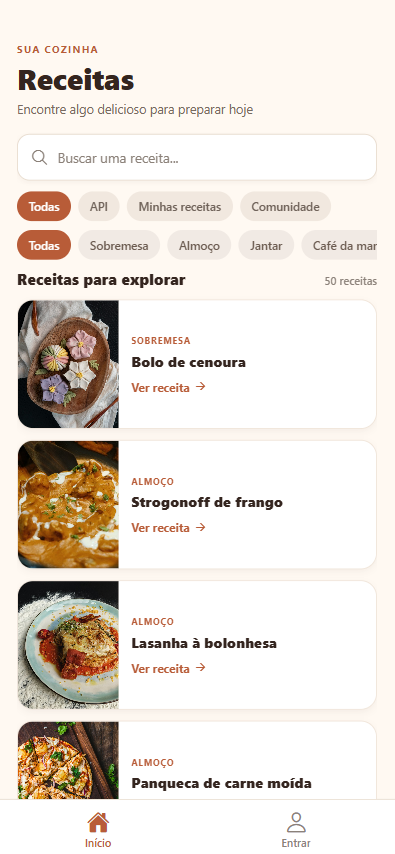
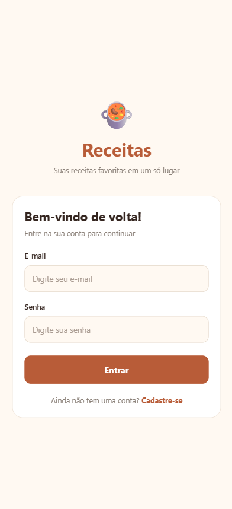
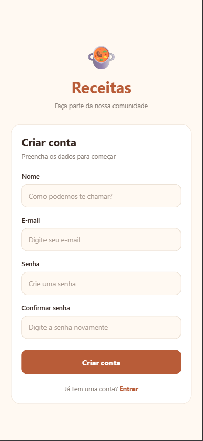
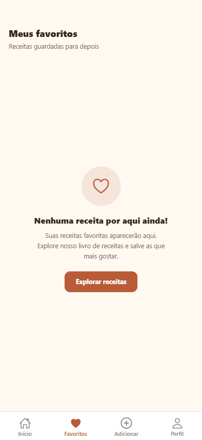
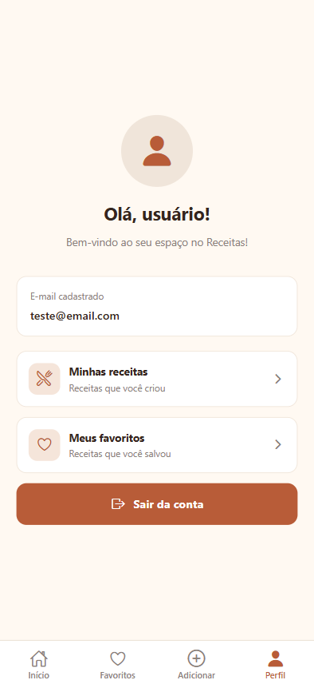

# Receitas

**Aluno:** Leo Matheus Casagrande

Aplicativo de receitas desenvolvido com React Native, Expo e Expo Router. Permite explorar receitas, pesquisar pratos, visualizar ingredientes e modos de preparo, criar receitas pessoais, compartilhar receitas com a comunidade e salvar receitas favoritas.

## Funcionalidades

- Exploração de receitas disponíveis no aplicativo.
- Pesquisa de receitas.
- Visualização de ingredientes e modo de preparo.
- Checklist para marcar os ingredientes utilizados.
- Cadastro e login de usuários.
- Criação e armazenamento de receitas pessoais.
- Publicação de receitas para a comunidade.
- Envio de imagens das receitas pelo Cloudinary.
- Sistema de receitas favoritas.

## Telas do aplicativo

- **Início:** apresenta as receitas disponíveis, com opções de pesquisa e filtros.
- **Tela para login e cadastro:** apresenta as opções de acesso e criação de conta.
- **Login:** permite que usuários acessem suas contas.
- **Cadastro:** permite criar uma nova conta.
- **Minhas receitas:** apresenta as receitas pessoais do usuário.
- **Adicionar / Editar receita:** permite cadastrar e editar receitas pessoais.
- **Favoritos:** apresenta as receitas salvas pelo usuário.
- **Perfil:** apresenta as informações e opções relacionadas à conta do usuário.

## Tecnologias utilizadas

- React Native
- Expo SDK 58
- Expo Router
- TypeScript
- Firebase Authentication
- Cloud Firestore
- Cloudinary

## Pré-requisitos

- Node.js em uma versão LTS compatível com Expo SDK 58.
- npm, instalado junto com o Node.js.
- Para Android: Android Studio com um emulador configurado ou um dispositivo Android com Expo Go compatível com a versão do projeto.
- Conexão com a internet para instalar dependências e acessar os serviços de receitas, Firebase e Cloudinary.

## Instalação

Abra um terminal na pasta do projeto (a pasta que contém o arquivo `package.json`) e instale as dependências:

```bash
npm ci
```

Se o projeto não tiver `package-lock.json`, utilize:

```bash
npm install
```

## Executar o aplicativo

### Android

Com um emulador já iniciado, execute:

```bash
npm run android
```

Ou inicie o servidor Expo:

```bash
npx expo start
```

Escaneie o QR code com o Expo Go compatível. O computador e o celular devem estar na mesma rede Wi-Fi.

Se houver problemas de conexão, tente:

```bash
npx expo start --tunnel
```

### Navegador

```bash
npm run web
```

### iOS

O simulador iOS requer macOS com Xcode instalado. Em um Mac, execute:

```bash
npm run ios
```

## Configuração do Firebase

O aplicativo utiliza Firebase Authentication para autenticação de usuários e Cloud Firestore para armazenar as receitas compartilhadas com a comunidade.

A configuração do projeto Firebase utilizado pelo aplicativo está em `src/lib/firebase.ts`.

No console do Firebase:

1. Ative o método de autenticação **E-mail/senha**.
2. Crie ou confirme o banco de dados do **Cloud Firestore**.
3. Publique as regras de segurança do Firestore incluídas no projeto.

Para publicar as regras, primeiro faça login:

```bash
npx firebase-tools login
```

Depois, execute:

```bash
npx firebase-tools deploy --only firestore:rules --project app-receitas-d5af2
```

O avaliador pode criar uma conta diretamente pela tela do aplicativo. A publicação de receitas na comunidade depende de autenticação e das regras do Firestore estarem configuradas corretamente.

## Imagens das receitas

O envio de imagens das receitas públicas utiliza o Cloudinary.

O aplicativo está configurado com um upload preset não assinado, definido em `src/lib/cloudinary.ts`.

O nome do projeto e as configurações necessárias já estão referenciados no código, portanto não é necessário criar um arquivo `.env` para executar o aplicativo.

## Verificação

Para verificar possíveis erros de tipagem no TypeScript, execute:

```bash
npx tsc --noEmit
```

O projeto também possui o comando de lint:

```bash
npm run lint
```

## Capturas de tela

As imagens abaixo apresentam as principais telas do aplicativo e estão armazenadas na pasta `screenshots`, localizada na raiz do projeto.

### Início



### Tela para login e cadastro


### Login



### Cadastro



### Minhas receitas


### Adicionar - Editar receita


### Favoritos



### Perfil



## Problemas comuns

- **O Expo Go não abre o projeto:** confira se a versão instalada é compatível com o SDK utilizado. Se necessário, utilize um emulador Android ou uma development build.
- **O aplicativo não conecta ao servidor Expo:** confirme que o computador e o celular estão na mesma rede ou utilize `npx expo start --tunnel`.
- **O login ou as receitas da comunidade não funcionam:** verifique a conexão com a internet, as configurações do Firebase Authentication, o Cloud Firestore e as regras de segurança publicadas.
- **As fotos não são enviadas:** confira a conexão com a internet e se o upload preset do Cloudinary está ativo.